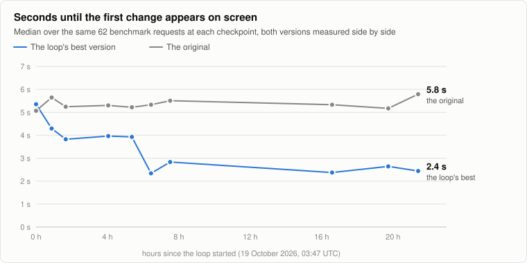
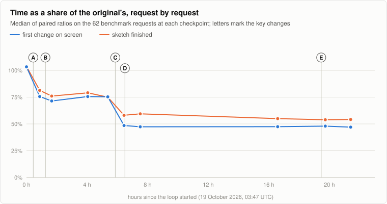
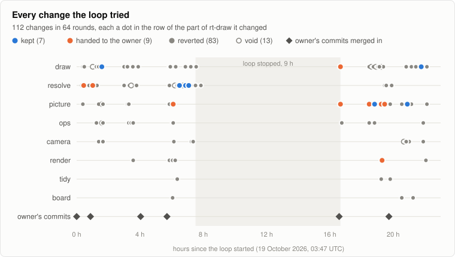
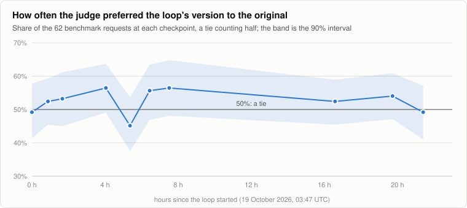
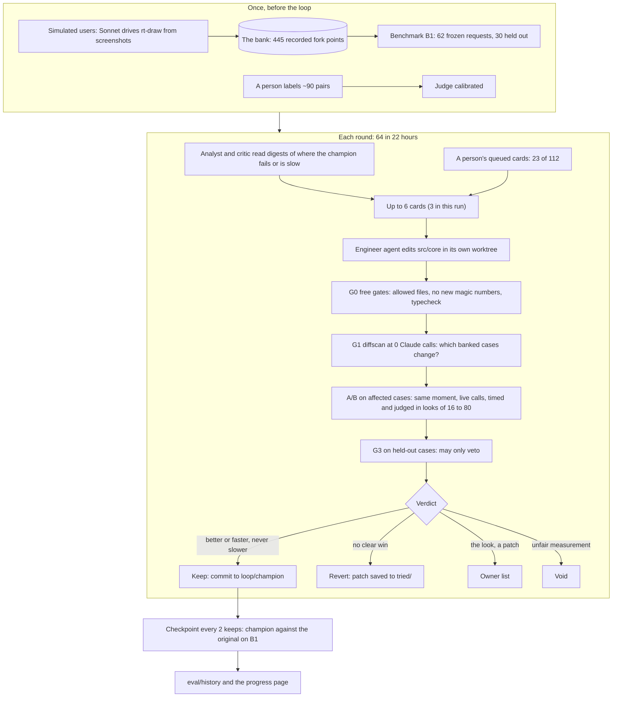

# How rt-draw got twice as fast by testing itself

<picture>
  <source media="(prefers-color-scheme: dark)" srcset="case-study/latency-dark.svg">
  
</picture>

In 22 hours of testing itself, rt-draw got about twice as fast. The wait for the first change on screen fell from 5.8
to 2.4 seconds, and the wait for a finished sketch from 7.1 to 3.9 seconds. A program tried 112 changes, timed and
judged each one against the best version so far, and kept the winners. No person timed a request or judged a drawing:
an AI judge, checked against a person's judgment first, rated the drawings as good as before. (This run timed the first
change and the finished sketch; the loop now decides on time to first drawing and the engine's render time alone, as
`LOOP-V2.md` says.)

## The short version

- **The goal.** You talk and doodle, and rt-draw draws. Every second you wait makes it feel less like sketching with
  someone, so the goal was simple: faster, without drawing worse.
- **The loop.** A program that keeps trying small changes to rt-draw. It tests each one against the best version so
  far on hundreds of recorded requests, and keeps it only if it's faster or better and nothing got worse.
- **No person picking winners.** Ideas came from two places: the loop's own AI critic, which wrote 89 of the 112, and a
  queue a person could add to, which supplied 23. Either way, the loop built each change, measured it and decided. It
  hands a person only the calls that aren't its to make: in this run, a change that cost more money or changed how
  rt-draw looks (cost is now only reported).
- **The result.** 112 changes tried in 64 rounds: 7 kept by the loop, 9 handed to a person (who adopted 3), and 96
  thrown away.

## How it works, simply

The loop is a very patient tester that never gets tired:

1. **Record once.** AI "users" try rt-draw: they look at the screen, talk, scribble and press Enter, like people do.
   Each moment they press Enter is saved, with what they meant, so it can be replayed later. 445 moments were saved.
2. **Suggest a change.** An AI reads where rt-draw is slow or gets things wrong, and suggests up to three small
   changes: a setting, a different instruction to the drawing model, or a bit of code. A person can queue ideas too.
3. **Test it fairly.** The best version so far and the changed one get the same recorded requests at the same moment.
   A stopwatch times both. A judge looks at both drawings side by side, without knowing which is which.
4. **Decide.** Clearly faster or better, and nothing worse? Keep it. No clear win? Throw it away and remember not to
   try it again. Changes the look or the model? Ask a person.
5. **Check the big picture.** After every couple of kept changes, the best version is compared with the original on a
   fixed set of 62 requests. That's the chart above.

Speed is easy to measure; quality isn't. The loop trusts its judge because a person first labeled about 90 pairs of
drawings. The judge picked the same drawing as the person on 81% of the pairs where the person had a preference, close
to how often the person agreed with themselves when shown a pair again (88%).

## What it found

<picture>
  <source media="(prefers-color-scheme: dark)" srcset="case-study/steps-dark.svg">
  
</picture>

Most of the wait came before anything was drawn. To draw, rt-draw first works out what "this" or "that button" points
to (resolving the references), then asks the drawing model. The biggest wins cut that first step.

| | Change | Idea from | Measured when decided | Kept by |
| --- | --- | --- | --- | --- |
| A | The resolver answers without thinking first (it thought on 50 of 51 calls) | a person | first change ×0.66, done ×0.71, cost per request ×1.29 | a person, since it costs more |
| B | The drawing prompt asks for each shape before its text and its picture | the loop | first change ×0.93, done ×0.96 | the loop |
| C | Draw on a guess: Jev guesses the references in about 0.1 s and drawing starts at once; the drawing is kept only if the resolver agrees | a person | first change ×0.90 | the loop |
| D | Jev alone resolves, with no Claude resolver call; the shapes it's unsure of go to the drawing model as hints | the loop | first change ×0.96, then ×0.94 when decided again with follow-up sends | the loop |
| E | Smaller doodles: a shorter picture syntax (every element outlined unless it says otherwise), then at most 16, then 12 paths per doodle | a person, then the loop twice | done ×0.97, ×0.97, ×0.95 | a person for the first two (they touch the look), the loop for the last |
| F | On "add something" requests, a reminder that every shape needs a description of 6 words or more, since a shorter one is thrown away | the loop | quality: won clearly (Z 2.7 over 80 requests) | the loop |

Jev is TypeSafe AI's decision model: a yes or no, with a probability, for each candidate shape in one call of about
0.1 s. C and D rely on switches a person built into rt-draw that week, off by default, and each was turned on only once
the loop had measured it. The two biggest single steps, A and C, were a person's ideas that the loop measured and
confirmed; B, D, F and two of E's three steps were the loop's own.

Each "×" is the median of paired ratios on the requests the change affected, so they don't simply multiply. Measured
together at the last checkpoint: first change ×0.47, done ×0.54.

The kept changes live on the `loop/champion` branch, all in `src/core/`: `tuning.ts` (the settings), `prompts.ts`,
`draw.ts`, `resolve.ts` and `picture.ts`.

### What it threw away

<picture>
  <source media="(prefers-color-scheme: dark)" srcset="case-study/timeline-dark.svg">
  
</picture>

Most ideas don't work, and the loop is built for that. A few it rejected:

- **Drawing without thinking.** 10% faster to the first change, but the judge preferred the original 37 times to 22
  (21 ties). Reverted: the speed cost fidelity.
- **Sending every drawing call twice** and keeping whichever streams first. No faster at the median (×0.999) and 1.56
  times the cost. Handed to the owner, who didn't adopt it.
- **Changes too rare to measure.** A change that affects fewer than 32 of the recorded requests can't be judged fairly,
  so it's reverted and listed for a person.
- **13 void decisions.** The measurement itself was unfair, for example when one side started on cold processes 14% of
  the time and the other never did. A void is never a verdict on the change. The loop re-ran voids then, and every re-run
  voided again; now a void goes to a person, and every case is warmed up before it's timed.

The loop stopped for 9 hours in the middle (its proposers ran out of cards to try) until a person restarted it.

## Did quality hold?

<picture>
  <source media="(prefers-color-scheme: dark)" srcset="case-study/quality-dark.svg">
  
</picture>

At every checkpoint, the judge compared the best version with the original on the same 62 requests. 50% is a tie.
Every point's 90% band includes 50%: no measurable loss, and no measurable gain overall either, while the time halved.

30 of the 62 requests were never shown to the loop's proposers, to catch a change that only works on what it was tuned
on. At the last checkpoint, those scored 45% (90% band 33–56%) and the other 32 scored 53%. A second judge, for how
clean the page looks, scored 56% (47–63%). The per-request cost went down a little: $0.0158 against the original's
$0.0173 at list prices.

The numbers behind the charts

| Checkpoint | Hours | First change, original | First change, best | Done, original | Done, best | Paired ratio, first change | Paired ratio, done | Judge's share (90% band) |
| --- | ---: | ---: | ---: | ---: | ---: | ---: | ---: | --- |
| ck-01 | 0.0 | 5.07 s | 5.35 s | 6.39 s | 6.41 s | 1.03 | 1.04 | 49% (41–58) |
| ck-02 | 0.9 | 5.64 s | 4.29 s | 6.02 s | 5.00 s | 0.76 | 0.81 | 52% (45–59) |
| ck-03 | 1.7 | 5.25 s | 3.83 s | 6.71 s | 4.81 s | 0.71 | 0.76 | 53% (45–61) |
| ck-04 | 4.0 | 5.30 s | 3.96 s | 6.04 s | 5.22 s | 0.76 | 0.79 | 56% (49–64) |
| ck-05 | 5.4 | 5.22 s | 3.93 s | 7.20 s | 5.13 s | 0.75 | 0.75 | 45% (38–54) |
| ck-06 | 6.4 | 5.33 s | 2.34 s | 6.33 s | 3.44 s | 0.49 | 0.58 | 56% (47–63) |
| ck-07 | 7.5 | 5.51 s | 2.83 s | 6.89 s | 4.11 s | 0.47 | 0.59 | 56% (48–65) |
| ck-08 | 16.6 | 5.33 s | 2.38 s | 6.68 s | 3.60 s | 0.47 | 0.55 | 52% (45–59) |
| ck-09 | 19.7 | 5.17 s | 2.64 s | 6.83 s | 3.56 s | 0.48 | 0.54 | 54% (47–61) |
| ck-10 | 21.4 | 5.79 s | 2.44 s | 7.11 s | 3.89 s | 0.47 | 0.54 | 49% (41–57) |

Times are medians over the 62 requests. Hour 0 is 19 October 2026, 03:47 UTC. Checkpoint ck-00, a day earlier, used
an earlier judge and is left out.

## How the harness is built

From here on, the details. Every step below is plain code under `evals/` except the model calls, and every model call
goes through one gateway with a hard cap.

### Simulated users and the bank

A **driver** is Sonnet playing a user from the screen alone (`core/driver.ts`, `loop/drive.ts`). It gets a persona
(`core/personas.ts`): a first-timer who knows only the store-page blurb and a loose memory of a site they want, an
explorer, or a "breaker" who knows how the product works, as its public docs would say. A frozen scenario table (`core/scenarios.ts`) gives
each send an ask type (add, change, remove, move...) and a beat, a twist like an undo or a vague "make it pop". Each
turn the driver sees two screenshots, rates the last result, **writes down what it means before pressing Enter**, then
talks and draws. `core/synth.ts` turns its steps ("circle that box") into what a person produces: timed words and
messy ink on one clock, so the product gets exactly what it would get from a real user.

Every Enter is a **fork point**: the scene before, the words, the ink, the screenshot and the stated intent
(`loop/bank.ts`). The bank records them once, on the champion of the day, and every decision reuses them, so no
decision pays for a driver. Cases are split three ways: **tuning** (the only ones the proposers ever read),
**H-gate** (held out, a veto for keeps) and **H-chart** (held out, half of benchmark B1, which the charts above use).

### Proposing a change

Each round, the **analyst** reads digests of at most 40k tokens built by frozen code from the bank and the runs
(`optimizer/digest.ts`): where the champion itself fails first, then slow traces. It brainstorms hypotheses, one idea
each, and may read the champion's code and research on the web. The **critic** turns those into up to six **cards**,
each one change with its goal (latency, fidelity or craft) and its risk. Both are read-only Agent SDK sessions. Any
model may be switched, or a send routed to one of several by how hard it is; each is measured like any other change. A
sweep (one knob at several values, stopping at the first keep) and a combination of near wins (reverted changes that
leaned the right way) are one card each (`LOOP-V2.md`, D). An **engineer** (an Agent SDK session that may also read
docs on the web) implements a card in its own git worktree. A candidate may only change `src/core/`, minus speech;
every new number in it must become a named knob in `tuning.ts`. A person's cards go through the same queue: the seed
cards (`optimizer/seed-cards.json`) start the first rounds, and `--seed-cards` adds more to a running loop.

### The funnel: free first, paid last

1. **G0, free gates** (`optimizer/gates.ts`, 0 calls): allowed paths, the magic-number lint, no new network or speech,
   `tsc` in the candidate's tree, and every banked scene through the candidate's `Scene.fromJSON` when `scene.ts`
   changed. A diff in the measuring side or the editor's look goes to the owner list, never back to an engineer.
2. **G1, the diffscan** (`loop/diffscan.ts`, 0 Claude calls): both versions run every banked case with the bank's recorded
   replies served instantly. A Jev question the bank never recorded (a router newer than the bank) is asked live, both
   versions sharing the answer: ~0.1 s and next to free, and without it a change to how the answer is used read as N.
   A case is affected when any request, the scene after or the rendered stage differs; only
   affected cases are ever paid for. The scan also classifies the change: N (no effect), S (speed only, from a timed
   replay), Q (a request differs), R (a render differs) or D (dialogue: state only a later send reads).
3. **G2, the A/B** (`loop/ab.ts`): both versions start from the same fork point on freshly reloaded pages and get the
   case at the same moment, in a seeded, alternating order, with live model calls. Every case is timed (time to first
   drawing, and the engine's render time; first change and done are reported) and, for quality cards, judged. First
   drawing counts only visible ink: a shape already on the board once it visibly changed, a shape with a picture once
   an element of its final picture or its final words show. Render times both engines on both arms' boards, in one view, each
   frame on content no earlier run painted, keeping of each board only what both engines load and apply alike.
4. **G3 and G4**: every keep, whatever its class, must also hold on the affected H-gate cases, on fidelity and on both
   deciding latencies, and a dialogue change on continuation sends.

### Deciding

All of it is in `loop/verdict.ts`, with frozen numbers in `loop/config.ts`. Statistics treat the driver session as the
unit, since sends from one session are alike (`loop/stats.ts`: clustered standard errors, and for latency a test
that swaps the arms of whole sessions, exact at any number of sessions; session bootstraps are reported only).

- **Quality cards (Rule F).** The judge's verdicts are checked in looks at 16, 32, 48 and 80 affected cases. Keep when
  the clustered Z reaches 2.3, 1.8 or 1.4 at looks 32, 48 or 80; revert as soon as it falls under -0.2, 0.3, 0.7 or 1.4.
  A clear result stops early, so a dud costs 16 cases, not 80.
- **Latency cards.** Keep when the median paired ratio (time to first drawing, or render) is surely under 1.0 (the
  swap test's p under 0.10), or a slow-send tail (p90, p95) is surely under 0.95 and at least 10% faster, the other
  latency isn't surely slower, and
  fidelity holds: Z of at least 0 at look 32, -0.5 at 48, -1.0 at 80. A
  fidelity Z of -1.25 or worse ends it: the speed costs fidelity.
- **Vetoes.** Surely slower at all on time to first drawing or render, at the median or a tail: one swap test over
  all of them, the A/B's cases and the held-out ones together, family-wise p under 0.05; losing on held-out cases; more empty sends or failed pictures; a
  render() that leaves work for after it returns. A case only one arm failed is that arm's loss (not an empty send).
  Cost is reported, never a veto (`LOOP-V2.md`).
- **Sweeps and combos.** A sweep's values, or a combo's near-wins, share one card's chance of a false keep: each needs
  a higher Z, or a smaller p.
- **Void.** A case that trips an invariant (a timing stall, unequal cold starts, an arm dispatched first too often)
  is never a product result, and too many voids void the decision.

### Checkpoints: the stable yardstick

After every second keep, `loop/checkpoint.ts` runs the champion against the frozen original (A0) on benchmark B1, live
and unshared, judged for fidelity and craft on every case. That gives the champion's share with a 90% bootstrap, the
latency ratios in the same run, an overfitting gap (tuning against held out), health numbers and a trust level; a
champion surely slower than A0 goes on the owner list. Changing the judge or the benchmark starts a new **era**, charted
apart: nothing bridges two eras. Era 2 began at hour 0.

### The judge

Sonnet at high effort (`judge/judge.ts`, prompts frozen in `judge/prompts.ts`). Once per case it writes an expectation
from the before image and the stated intent. Then **fidelity** sees the before image, both results and both change
lists, and says which did what was meant; **craft** sees the screens alone. Left and right are balanced exactly, and a
low-confidence verdict, plus a random fifth of the rest, is asked again with the sides swapped. Editing a word of a
judge prompt starts a new era.

Before the loop could run, it had to pass **calibration** (`judge/calibrate.ts`): the owner labeled pairs at
`/evals/label/`, never knowing which side was which, mixing real near-ties, clear contrasts and bias probes ("did
more", "did nothing"). The first check asked for more labels; the second passed: 81% agreement on 56 decisive pairs and
33 of 40 clear ones, against the owner's own 88% on repeats.

### Measuring time fairly

Every model call goes through `loop/gateway.ts`, its own process so the coordinator's work can't delay a stream. Calls
are never queued (a queue would read as model latency); each case slot pools its processes like one user's server.
Byte-identical requests from both arms share one real call, each arm getting the chunks on its own clock
(`loop/cache.ts`). An event-loop delay over 20 ms voids the case. `--cap n` refuses call n+1, so a loop or retry bug
stops at the cap instead of burning a usage window.

### Guard rails

The loop stops itself on the weekly allowance (50%), two voids in a row, a broken invariant, failed readiness or
calibration, or a merge conflict. It pauses, before any paying case, while every token is past 90% of its five-hour
window (and before every top-up or continuation send). After six reverts in a row (an epoch's cards)
in one area it rests that area until the next checkpoint. Everything it can't decide lands in `owner-list.md`.

### Why it's built this way: v1 cost too much

rt-draw v1 had a loop too. It worked: 126 wins, 13 losses and 11 ties over 150 pairs, and speech end to change went from
4.0 to 1.5 s. But each decision took about 2 hours and a quarter to a third of a five-hour usage window, and two
accounts' windows were gone in one day.

- v1's coordinator was an Opus session that re-read ~375k tokens a request; here it's a script (`loop/coordinator.ts`).
- Every v1 call wrote the 1-hour cache (half its use); here every call is 5-minute cached and metered.
- v1 re-ran whole sessions for every change; here fork points are banked once and only affected cases are paid.
- No step makes a real call without `--cap n`.

The 64 rounds here made 21,182 model calls, about $217 at API list prices; a decision averaged about $1.70 and 7
minutes.

## What a person did

No person timed a request, judged a drawing or picked a winner from the numbers. A person:

- built the harness with Claude Code, from 16 to 19 October 2026;
- labeled about 90 pairs once, to calibrate the judge;
- wrote the cards behind 23 of the 112 changes tried: the 8 seed cards that started the loop and about ten more during
  the run, A and C among them;
- made the calls the loop handed over: adopted three ideas (A, and E's shorter picture syntax and 16-path cap) and
  declined five (sending calls twice, a costlier resolver race, two changes to how rough the drawing looks, and a
  picture-size rule); one idea was handed over twice;
- built switches the loop could then try (Jev as the resolver, drawing on a guess, sending calls twice) and fixed
  harness bugs the owner list surfaced; those commits were merged into the champion 6 times, each followed by a
  checkpoint;
- restarted the loop after its 9-hour stop.

## The code and the data

Names that look alike: **A0** is the frozen original every checkpoint runs against, **B1** the frozen benchmark,
**U1** the owner's recorded sends and **R1** testers' real sends with gold (`real/README.md`). **G0** to **G4** are the
funnel's gates; the case study's **A** to **G** are changes. A class (**N**, **S**, **Q**, **R**, **D**) is what the
diffscan says a change touches; a **slot** is a case slot in a run, and also a token's place in the tokens file.

| Where | What |
| --- | --- |
| `core/` | the driver's prompt and parsing, personas, the frozen scenario table, synthetic speech and ink |
| `driver/` | a demo page to watch a driver use the product |
| `bridge/` | the page each arm runs the product in, with the harness's own clock and ink overlay |
| `fixtures/` | frozen start scenes and their baked pictures |
| `loop/` | the CLI (`run.ts`, its commands in `commands/`, one decision in `decide.ts`, the loop in `coordinator.ts`, the command line in `rte.ts`), gateway, bank, A/B runner, diffscan, verdicts, statistics, checkpoints |
| `judge/` | the judges, their frozen prompts, calibration and a canary |
| `optimizer/` | the analyst, critic and engineer, their digests, prompts and gates, and the seed cards |
| `progress/`, `label/`, `pages/` | the progress page, the labeling page and their server |
| `mock/` | a fake API that answers every role, to rehearse the whole chain at 0 calls |
| `checks/` | the harness's own tests, `t0` to `t22` |
| `case-study/` | this page's charts: `node evals/case-study/charts.ts` redraws them from `eval/history` |

- **`eval/history`** is the loop's record: every decision (`decisions.jsonl`, readable in `ledger.md`), checkpoint,
  round and budget line, the owner list, each run's verdict and every reverted patch in `tried/`. The 445-case bank
  itself isn't in git.
- **`loop/champion`** is the best version found.
- **The progress page** reads `eval/history` straight from git: `git fetch origin eval/history:eval/history`, then
  `./node_modules/.bin/vite --config evals/pages.vite.config.ts --port 5181` and open
  http://localhost:5181/evals/progress/.
- **Running the loop yourself:** `evals/RUNBOOK.md` has every command, cap, cost and time. Code comments cite the
  design spec by section (§1 to §12); the spec itself isn't in this repo, and where they differ, `evals/LOOP-V2.md`
  and the code are what holds.
